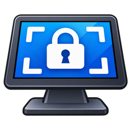

<p align="center"></p>

# Front Desk Kiosk

A small, free Windows program that locks a PC to **one web page**: a check-in screen, booking page, menu, sign-up form, or whatever you need. The page fills the screen with no tabs, no address bar, and no way to switch to other apps. Getting out takes an admin password.

It's meant for reception desks, waiting rooms and shop counters. It works on **Windows 10 and 11, including Home edition**, which can't use Windows' own kiosk mode.

- One file, no installer, nothing else to install
- Change the web address and password any time from a password-protected admin window
- Starts automatically when Windows signs in
- Remote-control tools like TeamViewer or AnyDesk keep working
- Recovery code, plus documented fallbacks, in case the password is forgotten

## Contents

- [What it blocks](#what-it-blocks)
- [How secure is it?](#how-secure-is-it)
- [Installing](#installing)
- [Daily use](#daily-use)
- [Forgot the password?](#forgot-the-password)
- [Removing it](#removing-it)
- [Files and privacy](#files-and-privacy)
- [Building from source](#building-from-source)
- [License](#license)

## What it blocks

| Way out | What happens |
|---|---|
| Windows key, Start menu, taskbar | Blocked / covered |
| Alt+Tab, Alt+Esc, Alt+F4, Ctrl+Esc | Blocked |
| Ctrl+N, Ctrl+T, Ctrl+P, F5, right-click menu, developer tools | Turned off |
| Links that open a new tab or window | Open in the same view instead |
| Downloads | Cancelled |
| Ctrl+Shift+Esc (Task Manager) | Blocked |
| Ctrl+Alt+Del | No program can block this. Instead, **Task Manager, Lock, Sign out and Change password are removed** from that screen while the kiosk runs. Only *Switch user*, the power button and *Cancel* are left. |
| Second monitor | Covered with a black screen |
| Wi-Fi not ready at boot / page fails to load | Retries every 15 seconds |
| Program crashes | Restarts itself |
| Screen sleep | Kept awake while the kiosk is running |

Pages are shown with Microsoft's **WebView2**, the Chromium engine that Chrome and Edge are built on. It comes with Windows 11 and is already on most Windows 10 PCs; if it's missing, install the free [WebView2 Runtime](https://developer.microsoft.com/microsoft-edge/webview2/). Sites behave like they do in Chrome. Cookies and logins are kept between restarts, so a page that signs in once stays signed in.

## How secure is it?

It's built to stop **customers, visitors and staff from wandering off the page**. It doesn't stop someone determined who has physical access to the PC. Anyone who can restart the computer into Safe Mode can turn it off. That's deliberate, and it's the last-resort recovery route described below. Windows' own kiosk mode (Windows Pro and above) has the same limitation.

- Passwords are never stored. Only a salted PBKDF2-SHA256 hash is saved.
- Everything it changes in Windows is per-user and is put back when you exit properly. That includes any of these restrictions you already had in place.
- It doesn't need administrator rights and doesn't send any data anywhere.

## Installing

1. **Download `FrontDeskKiosk.exe`** from the Releases page, or [build it yourself](#building-from-source).
2. Put it somewhere permanent, e.g. `C:\FrontDeskKiosk\FrontDeskKiosk.exe`. Auto-start remembers this location, so don't run it from Downloads or a USB stick.
3. Double-click it. Because the program isn't code-signed, Windows will probably show **"Windows protected your PC"**. Click **More info → Run anyway**.
4. In the **first-time setup** window:
   - Enter the web address.
   - Choose an admin password (type it twice).
   - Press **Save and start kiosk**.
5. A **recovery code** appears. **Save it in a password manager or write it down.** It works in place of the password if you forget it.
6. A **Front Desk Kiosk** shortcut is put on the desktop. Use it to turn the kiosk back on after exiting.

> **Before relying on it:** if you manage the PC remotely, set up your remote-access tool for unattended access and **test a remote connection first**.

The kiosk now starts every time Windows signs in.

### Make the PC sign in by itself (recommended)

So the kiosk comes back after a power cut or Windows update without anyone typing a PIN:

1. **Settings → Accounts → Sign-in options**: turn **off** "For improved security, only allow Windows Hello sign-in…".
2. Press **Win+R**, type `netplwiz`, press Enter.
3. Untick **"Users must enter a user name and password to use this computer"**, press OK, and enter the account's password.

If that checkbox doesn't appear, Microsoft's free [Autologon](https://learn.microsoft.com/sysinternals/downloads/autologon) tool does the same job.

A dedicated Windows account just for the kiosk is a good idea, but not required.

## Daily use

**Open the admin window:** press **Ctrl+Shift+F12**, or tap the **top-left corner of the screen 5 times** quickly (for touchscreens). This works through remote-control tools too.

| In the admin window | Password needed? |
|---|---|
| **Back to kiosk** (also reloads the home page, handy for a stuck page) | No |
| Change the **web address** | Yes |
| Change the **password** | Yes (current password first) |
| Turn auto-start on or off | Yes |
| Make a new recovery code | Yes |
| **Exit to Windows** | Yes |

If nobody touches the admin window, it closes and the kiosk carries on after 60–90 seconds.

**At startup** the same window appears with a 20-second countdown, then the kiosk starts automatically. That gives you a chance to unlock and change settings at boot.

**After exiting**, turn the kiosk back on with the desktop shortcut, or restart the PC.

## Forgot the password?

Try these in order. Replace `<user>` with the Windows user name.

1. **Recovery code.** Type it into the *Admin password* box and press Unlock. Dashes and capital letters don't matter. Then choose a new password.

2. **Remote file access (no password needed).** With a tool like TeamViewer (*Files & Extras → File transfer*):
   1. Delete `C:\Users\<user>\AppData\Local\FrontDeskKiosk\settings.json`.
   2. Send **Ctrl+Alt+Del** and click the **power icon → Restart**.
   3. The kiosk comes back in first-time setup, where you choose a new password and enter the web address again.

   Website logins are kept.

3. **At the PC.** The kiosk doesn't start in Safe Mode:
   1. Press **Ctrl+Alt+Del**, then hold **Shift** while clicking the **power icon → Restart**.
   2. Choose **Troubleshoot → Advanced options → Startup Settings → Restart**, then press **4** for Safe Mode.
   3. Sign in. Safe Mode needs the account's actual **password**. A PIN doesn't work; for a Microsoft account, use the Microsoft account password.
   4. Delete the same `settings.json` file and restart normally.

   If Shift+Restart doesn't open the blue menu: turn the PC off with the power button while Windows is loading, twice in a row. The third boot opens the recovery menu.

## Removing it

Unlock → untick auto-start → **Exit to Windows**. Then delete the exe, the desktop shortcut and `C:\Users\<user>\AppData\Local\FrontDeskKiosk\`.

If the program was ever force-closed and Task Manager / Lock / Sign out are still missing afterwards: start the kiosk once and exit it properly. That restores them.

## Files and privacy

Everything lives in `C:\Users\<user>\AppData\Local\FrontDeskKiosk\`:

| File | Contents |
|---|---|
| `settings.json` | Web address, auto-start setting, **hashed** password and recovery code |
| `policy-backup.json` | Original Windows settings, kept only while the kiosk is running |
| `Browser\` | The web view's cookies and logins |
| `kiosk.log` | Troubleshooting log (no passwords) |

Windows settings it changes while running (all under `HKEY_CURRENT_USER`, all restored on exit):

- `Software\Microsoft\Windows\CurrentVersion\Policies\System`: `DisableTaskMgr`, `DisableLockWorkstation`, `DisableChangePassword`
- `Software\Microsoft\Windows\CurrentVersion\Policies\Explorer`: `NoLogoff`
- `Software\Microsoft\Windows\CurrentVersion\Run`: `FrontDeskKiosk` (auto-start, while enabled)

Nothing is sent anywhere except the web page you choose to show.

## Building from source

You need the [.NET 8 SDK](https://dotnet.microsoft.com/download/dotnet/8.0). It builds on Windows, macOS or Linux:

```bash
dotnet publish -c Release -o publish
```

The result is a single self-contained `publish/FrontDeskKiosk.exe` (~70 MB). The PC running it doesn't need .NET installed.

| File | What it does |
|---|---|
| `KioskForm.cs` | Full-screen window and browser |
| `SettingsWindow.cs` | Start-up / admin window |
| `Lockdown.cs` | Keyboard blocking, Windows restrictions, auto-start, desktop shortcut |
| `KioskConfig.cs` | Settings file and password hashing |
| `Program.cs` | Start-up, single instance, crash restart |

Some antivirus tools are wary of unsigned programs that intercept the keyboard. Building it yourself from this source is the easiest way to know exactly what you're running.

## License

[MIT](LICENSE). Free to use, change and share. Provided as-is, with no warranty.
